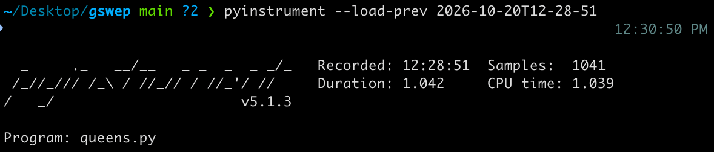
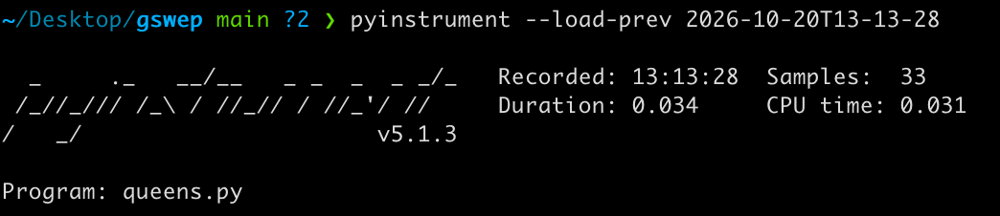

# Improvement 1

The first solution used brute force/backtracking, where I went through every square on the board and chose to place or skip a queen. After each placement, I would call `validQueens()` which would create a 2D array representing the board and calculate all the squares the queens can attack.

This was inefficient because this kept building a new board and recalculating the same queens every placement.

To improve this, I used a dictionary to keep track of how many queens were attacking each square. This alllowed me to automatically skip the squares we already know the queen is attacking.

This reduced the execution time from 1.042 seconds to 0.034 seconds.

## Before:

## After:
